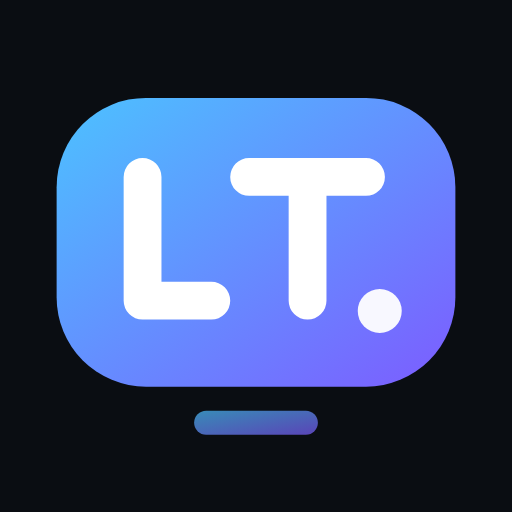
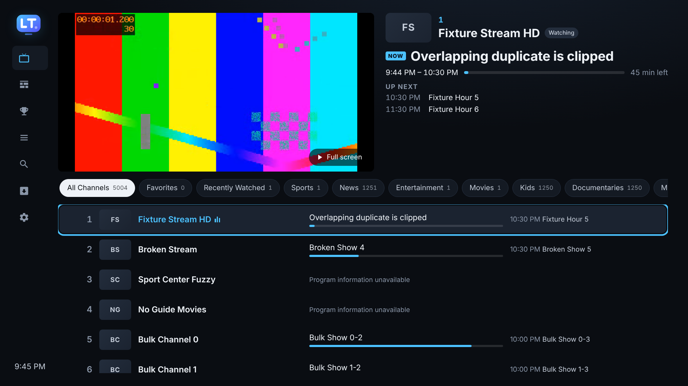

<p align="center"></p>

# LTTV — IPTV playlist organizer, program guide & player

LTTV turns **your own** IPTV playlist (M3U/M3U8) and XMLTV program guide into a clean, cable‑box style TV experience. It runs on the desktop and on Amazon Fire TV / Android TV, and is fully usable with a TV remote.

> LTTV does not include channels, streams or subscriptions. Only add playlists and guides you are authorized to use.



## What it does

- **Sign in with your provider**: most IPTV services give you a server address, username and password (“Xtream Codes” login). Enter those and LTTV checks the login (shows your subscription expiry), then loads the channels and the provider's TV guide automatically. HLS or MPEG‑TS format selectable.
- **Import** playlists from a URL or a local file (multiple playlists supported), and XMLTV guides from a URL or file (`.xml` or `.xml.gz`). A step‑by‑step wizard validates, parses, matches and summarizes everything. Large files are parsed in a background worker so the UI never freezes.
- **Live TV = the guide**: one screen with the live preview, what's on, and the program grid. Tabs are one per **country**, taken from the provider's own country code on each playlist group (`US|`, `CA|`, `UK:`, `ES|`, `[AR]`…) and shown on the tab (e.g. “US · United States”). Every channel in a group goes under that group's country, so each provider category sits under exactly one country; groups without a code follow the code most of their channels carry, otherwise they're under “Other”. Choosing a country opens its menu: **All channels**, **My TV** (US) and **every one of your playlist's own groups** for that country, in your provider's order (e.g. AT&T, DIRECTV, Sports, NFL Sunday Ticket). Channels without a country tag follow the rest of their group, so whole provider groups land under the right country. Favorites, recents and categories are still in Channels and Search.
- **Channel logos**: matching high-quality transparent logos from the free [tv-logos](https://github.com/tv-logo/tv-logos) collection replace the playlist's logos (loaded from GitHub; only exact name matches within the channel's country are used, otherwise the playlist logo stays). Can be turned off in Settings.
- **Descriptions for what's on**: when the guide lists a programme without a description, LTTV finds one and labels where it came from — games from the sports schedule (teams, records, stakes, venue, live score, TV), shows and episodes from [TVmaze](https://www.tvmaze.com), movies from Wikipedia. Only exact title matches are used; otherwise it says “No description available”. Descriptions for what's on in the rows on screen are fetched in the background, so they're ready when you get there.
- **English first**: when the guide has a programme in several languages, the English title and description are used. If an English channel (US, UK, Canada, Australia, Ireland, New Zealand) has its guide in Arabic or another script — e.g. MeTV — LTTV switches it to an English version of that channel from your other guide data or your provider; if there is none it says so instead of showing foreign text as the description. (Can be turned off in Settings.) Shown in the guide, the player's info panel and overlay, and program details.
- **Organize automatically**: categories from `group-title` (Sports, News, Movies, Kids, Documentaries, Music, International, …) with the evidence shown (“from group”, “from name”, “set by you”); tidy channel names (redundant `US:`‑style prefixes removed only when redundant, HD/4K/+1/East/West kept, original name always kept and restorable); duplicate detection (same URL, or same name + tvg-id + quality) that never merges channels.
- **Customize**: favorites, hide, rename, custom channel numbers, custom category, custom order (drag & drop on desktop, “Move position” with the remote), ten sort modes including **country** and **provider (playlist)**, plus Country and Provider filters.
- **My TV**: your channels laid out on **DIRECTV's New York / New Jersey lineup** exactly as listed on [directv.com/channel-lineup](https://www.directv.com/channel-lineup/) (ZIP 07764, Oct 2026): the local stations (2 CBS, 4 NBC, 5 FOX, 7 ABC, 9 My9, 11 PIX11, 13 THIRTEEN, 41, 47, 49, 50, 55, 4051), every package channel (ESPN 206, CNN 202, Fox News 360…), add-ons and regional sports (YES 631, SNY 639, MSG 634…), Spanish, international and the free MyFree DIRECTV channels (4000s) — 471 channels. Choose *Sort → My TV* to number the lineup that way (type 206 for ESPN), or *United States → My TV* on Live TV. For each slot LTTV picks your best copy (4K > FHD > HD, US feed, East feed, not +1). The local slots (CBS 2, NBC 4, FOX 5, ABC 7…) only take the **New York stations** — a channel whose name, tvg-id or guide channel says WCBS / WNBC / WNYW / WABC or New York. A plain “US: NBC” feed isn't assumed to be New York's (providers' unlabeled feeds are often another city's station), and those slots show the New York station's own guide listings when your guide has them. To choose the exact stream for a number, open the channel's options (Menu ☰) → **Always use this stream for My TV N**; pinned streams win over other copies.
- **Switching provider keeps your setup**: My TV pins, favorites, renames, hidden channels, custom numbers and categories move to the same channels on a new provider — matched by tvg-id, or by name once provider prefixes ("A3", "US:") and quality words (HD, FHD, RAW) are ignored; My TV pins also match by the station's call sign (WABC, WNBC…). Everything else (My TV lineup, sports, guide fixes, theme) doesn't depend on the provider.
- **Fresh listings**: Live TV has an **Update listings** button (with when they were last updated); guides are also refreshed automatically on your schedule and early when their listings are about to run out.
- **Program guide (EPG)**: a real time‑grid built from your XMLTV data, positioned by actual start/end times (DST‑safe), now‑line, progress bars, jump to now, ±2‑hour jumps, program details. Channels without data say **“Program information unavailable.”**
- **Guide matching** in strict priority: `tvg-id` → `tvg-name` → normalized name → fuzzy. Country prefixes (`USA ESPN`, `UK - Sky Sports`) and the same channel listed in several guides are handled automatically. Fuzzy suggestions show a confidence and are **never used until you approve them** (approve all ≥ 80/90% in one go, or auto‑approve ≥ 85/90/95%). Your decisions survive refreshes.
- **Provider guide for missing channels**: for “username & password” (Xtream) providers, channels the guide file doesn't cover get their listings straight from the provider (fetched only for channels on screen, cached for a few hours).
- **Live events show the game**: event slots like `NFL 03`, `PPV 2` or `ESPN+ 14` are shown as the game that's on now (e.g. **Bills vs Jets** · NFL 03), from the provider's channel name or the guide, everywhere in the app; playlists with event channels are refreshed every 4 hours so names stay current.
- **Live playback**: Fire TV uses native **Media3/ExoPlayer** (HLS, DASH, MPEG‑TS, MP4; hardware decoding). Desktop uses hls.js; raw MPEG‑TS channels play too: LTTV converts them in the browser (mpegts.js), or with ffmpeg if it's installed. Larger buffers tuned for IPTV, and Xtream channels that fail in one format (`.m3u8`/`.ts`) are retried in the other automatically (the working format is remembered). Automatic reconnect with back‑off, stall detection, clear error messages, channel up/down, favorites‑only zapping, recent channels, info overlay.
- **Movies and Shows** (only when your provider has them): if your “username & password” (Xtream) provider offers movies or series, or your M3U playlist contains movie/episode entries, **Movies** and **Shows** appear in the menu — otherwise they stay hidden. The home page is laid out like Hulu: a featured banner on top (artwork, description, Play / Details), then rows instead of tabs: **Continue watching**, **Popular Movies / Popular Shows** (your provider's own Trending / Popular / Top 10 lists, plus titles from Apple's public iTunes charts that are in your provider's list), **New Episodes** (shows with a new episode on US TV or streaming this week, from TVmaze's schedule), **Recently Added**, **Critically Acclaimed** (the provider's ratings) and English genre and service rows (Action & Adventure, Comedy, Drama, Horror, Kids & Family, Netflix, Disney+…), built from your provider's English categories; **Browse categories** and **Other languages** at the bottom. Search opens only when you choose it. **Quality**: when the provider has a title more than once (4K, FHD, HD…), it's shown once and the 1080p copy is picked (4K and others selectable on the details page; the file's resolution is shown); streams with several qualities play at the highest. **Artwork and descriptions**: sharper posters, episode stills, episode names and summaries from TVmaze (shows) and Apple's iTunes catalogue (movies), Wikipedia as a fallback for movie descriptions — exact title and year matches only (IMDb has no free public API). **Captions**: CC button in the player and a Settings switch, for videos and channels that carry subtitles. **Continue watching** has one card per show (the episode watched last); choosing it — or backing out of an episode — opens the show's page with that episode (or the next one, if finished) selected. Details (plot, cast, runtime), seasons and episodes, resume, Start over, next episode plays automatically. Everything plays from your own provider.
- **Fantasy and Bets** live inside each football and basketball league (NFL, NBA, college): Games · Fantasy · Bets. Players are grouped by position (QB, RB, WR, TE, K, defense; guards, forwards, centers), only positions that have props are listed, and each player gets the props for his position. Lines are typed with an on-screen number pad that has a decimal point (74.5). **Parlays**: build one from several player and team props; it's tracked leg by leg (✓ / ✗) and wins only if every leg hits (pushed legs drop out). With a **team bet**, every score in that game pops up (score line, scoring team's logo, the play) until the bet is decided; a decided bet says **BET HIT** / **BET LOST** once and then goes quiet. Pop-ups appear only while a sports channel or game is playing, queue up so none are skipped, and sit in the bottom-right corner.
- **Sports**: follow your teams (NFL, NBA, WNBA, MLB, NHL, MLS, Premier League, major European clubs, or any custom team). LTTV finds their games in **your own guide data**, shows what's live now and coming up, on which of your channels, lists team channels in your lineup, lets you set “remind me” for upcoming games, and shows a banner on Live TV when your team is playing. Nicknames that are everyday words or shared by two leagues (“Heat”, “Giants”) only count with league context or a recognised opponent, so you don't get false matches. LTTV doesn't add any streams; it only points to channels already in your playlist.
- **Sports**: pick a league (with today's game count and live games) — NBA, NFL, MLB, NHL, **UEFA Champions League**, EPL, Bundesliga, Serie A, Ligue 1, LaLiga, MLS, CBB and CFB with yesterday/today/tomorrow's games, live scores and **team logos** (transparent, no background), from ESPN's public scoreboard feed. For every game LTTV finds the **best channels in your own playlists**: event channels naming both teams, guide listings, the national network, and the teams' regional sports networks. When both teams have their own local broadcast (e.g. YES vs NESN) it **asks which team's broadcast you want** and puts that RSN first. LTTV never searches the internet for streams.
- **Live rewind**: pause, **rewind, fast forward** and **go back to live** on live channels. On Fire TV LTTV keeps the last minutes of the channel on the device (30 min by default, up to 60; capped at 40% of free space), so it works for raw MPEG‑TS channels too; in a browser up to 10 minutes are kept in memory. Press OK in full screen for the controls bar (⏪ 10s · ⏯ · ⏩ 10s · Live), or use the remote's ⏪ ⏩ keys — repeated presses skip further (10 s → 30 s → 1 min). A bar shows how far behind live you are.
- **Sports teams**: the team picker lists every team of the NFL, NBA, WNBA, MLB, NHL, MLS, Premier League, Bundesliga, Serie A, Ligue 1, LaLiga, Champions League, college basketball and college football — straight from ESPN's team lists, with their logos (kept for a week) — plus your own custom teams. League cards always show the league's logo.
- **Fantasy** (Sports → Fantasy): add your players from any NFL, NBA or college roster; LTTV keeps their fantasy points live (PPR, half PPR or standard for football; points/rebounds/assists/steals/blocks for basketball) from ESPN's live game feeds and pops up in the bottom corner when they score — with the player's picture, team logo and the play.
- **Bets** (Sports → Bets): pick a player (or a team) and any prop — passing/rushing/receiving yards, receptions, TDs, combos, points, rebounds, assists, PRA, team points, game total, spread… — type your line (e.g. over 74.5 receiving yards) and LTTV tracks it live, pops up as it moves and when it hits. LTTV only tracks the lines you type; it doesn't place bets or show odds.
- **Look**: two themes — **Luxury** (black and champagne gold with thin rules, serif headings and an original owl-shaped TV logo) and **Aero** (Windows 7-style sky-blue glass). Settings → Theme switches between them (plus Dark, Black and High contrast).
- **Colors**: pick an accent color from 13 swatches or any hex value; the logo, buttons, focus rings and progress bars follow it.
- **Search** channels (name, original name, number, category) and programs (now and upcoming) with category/favorites/guide filters.
- **Settings**: time zone and 12/24 h clock, guide refresh interval, theme and accent, start screen, playback buffer/timeout/retries, export/import settings, clear cache, reset, diagnostics (secrets redacted).
- **Updates inside the app (Fire TV)**: LTTV checks for a newer build at start-up and every 6 hours (or Settings → Check for updates), downloads it itself and opens the installer — press **Install** and it updates over the current app, keeping all your settings. The first time, Fire TV asks you to allow LTTV to install apps.
- **Fire TV setup from your phone**: the TV shows an address and PIN; open it on your phone/computer to paste URLs or upload files instead of typing with the remote.

## Quick start — desktop

Requirements: **Node.js 20+**. Optional: **ffmpeg** (an alternative converter for raw MPEG‑TS channels; not required).

```bash
node server/server.mjs --open        # serves the prebuilt app at http://127.0.0.1:8787/
```

That’s all — the repository ships a prebuilt `dist/`, and the helper has no dependencies. Then click **Add playlist**, or **Try the demo** (clearly labeled test streams and a generated test guide; delete it any time in Sources).

The local helper (bound to `127.0.0.1` only) fetches playlist/guide/stream URLs on behalf of the page, because most IPTV servers don’t allow browsers to read them directly (CORS). It also forwards per‑channel headers (User‑Agent/Referer from `#EXTVLCOPT` or `url|User-Agent=…`), decompresses `.gz` guides, and refuses requests from other websites.

Use Chrome, Edge or Safari for playback; Chromium builds without proprietary codecs can’t decode H.264 (LTTV tells you when that happens).

### Keyboard / remote controls

| Remote | Keyboard | Action |
|---|---|---|
| D‑pad | Arrow keys | Move focus · in full screen ▲▼ change channel, ◀ channel list, ▶ program info |
| Select | Enter | Open / tune · OK on the playing channel = full screen · in full screen: controls (rewind, Live, Channels, Info, Options) |
| Back | Esc / Backspace | Close overlay, leave full screen, go back · on Home (TV) exit |
| Menu ☰ | M | Channel options (favorite, rename, number, category, hide, move, guide match) · player options |
| Play/Pause | Space | Pause/resume |
| ⏪ ⏩ | — | Full screen: rewind / fast forward (10 s, then 30 s, then 1 min) · Guide: jump 2 hours · lists: page up/down |
| Channel ± | PageUp/PageDown | Change channel |
| — | 0–9 (full screen) | Type a channel number |

## Fire TV / Android TV

The Android project is in [`android/`](android/) (Kotlin, Media3 ExoPlayer, AndroidX WebKit). It hosts the very same UI bundle, so desktop and TV share one data model and codebase. See **[docs/FIRE_TV_INSTALL.md](docs/FIRE_TV_INSTALL.md)** for building the APK (locally or with the included GitHub Actions workflow), signing, and installing on a Fire TV over the network or USB.

> **Device support:** Fire TV devices running **Fire OS** (all models before late 2025, e.g. Fire TV Stick 4K / 4K Max, Fire TV Cube, Fire TV Stick Lite/3rd gen, Fire TV smart TVs) can install the APK. The **Fire TV Stick 4K Select** and future Fire TV Sticks run **Vega OS**, which does not run Android apps — LTTV can’t be installed there. Android TV / Google TV devices work too.

## Development

```bash
npm install            # esbuild, TypeScript, tsx, playwright-core (vendored UI/player libraries need no registry)
npm run dev            # rebuild dist/ on change, then run `npm start` in another terminal
npm run build          # production build into dist/
npm run build:android  # build + copy into android/app/src/main/assets/www
npm test               # 61 unit/integration tests (parsers, time zones, matching, storage, helper server…)
npm run typecheck
node scripts/e2e.mjs --chrome /path/to/chrome   # 61 end-to-end checks driven only with remote-style keys
```

### Architecture

```
src/core/      Platform-independent logic (also used by the tests)
  m3u.ts         tolerant M3U/M3U8 parser (attrs, EXTVLCOPT/KODIPROP/pipe headers, stable channel keys)
  xmltv.ts       streaming XMLTV parser (chunk-safe), schedule normalization
  time.ts        XMLTV timestamps, IANA time zones & DST, formatting
  normalize.ts   title cleanup, match normalization, evidence-based categories
  match.ts       EPG matching engine (priority + guarded fuzzy, user decisions)
  organize.ts    lineup builder, numbering, duplicates, sorting, filters, reordering
  guide.ts       in-memory programme index + grid layout math
  search.ts      channel & programme search
  teams.ts       team catalog (names only) + custom teams
  sports.ts      finds favorite-team games/shows in the guide, team channels
  storage.ts     repository over a key-value backend; idb.ts = IndexedDB backend
  pipeline.ts    import/refresh pipelines shared by the worker and tests
src/app/       Browser runtime: state store, spatial navigation, worker, importer, player, platform bridge
src/ui/        Preact screens: Home (Live TV), Guide, Sports, Channels, Search, Sources, Wizard, Matches, Settings, Player
server/        Desktop helper (static files + /api/fetch, /api/probe, /api/remux)
android/       Fire TV app: WebView host + native ExoPlayer + native /api + LAN setup page
vendor/        Vendored sources: preact, hls.js and its small deps (see vendor/VERSIONS.md)
tests/         node:test suites and fixtures; scripts/e2e.mjs drives the real UI headlessly
```

Data lives in **IndexedDB** on the device (desktop browser profile, or the Fire TV app’s WebView storage): playlists, parsed channels, guide channels, per‑channel programme lists, customizations, match decisions, recents and settings. Customizations are keyed by a stable channel key (playlist + tvg‑id + original name + occurrence), so they survive token/URL changes when the playlist is refreshed. The source playlist is never modified.

## Privacy & security

- No accounts, no cloud, no analytics. Everything stays on the device.
- Playlist/guide URLs are shown redacted (host only, `?…` for queries) in the UI and diagnostics, and never logged in full by the helper or the Android app.
- “Export settings” omits source URLs unless you choose “Export incl. source URLs”.
- The desktop helper listens on `127.0.0.1` only and rejects cross‑site requests. The Fire TV setup page runs only while its dialog is open and requires a PIN.

## Known limitations

See [docs/VERIFICATION.md](docs/VERIFICATION.md) for the full verified / not‑verified checklist. In short:

- The APK could not be built in the environment this was developed in (no access to Google’s Android SDK/Maven); the Android code was type‑checked against the real Android API plus stubbed AndroidX/Media3 signatures and the UI↔host contract was tested with a simulated bridge. Build it with the GitHub Actions workflow or Android Studio.
- No recording or catch‑up of past programmes — live TV has live rewind only (you can go back as far as LTTV has kept since you tuned in). Movies and shows play only when your own provider offers them (Movies / Shows screens); movie/episode entries in an M3U are kept out of the channel list.
- Live rewind on Fire TV records to the device's storage while you watch (about 75 MB per minute for a 10 Mbit/s channel; deleted when you change channel). It hasn't been tried on real hardware yet. In a browser it is limited by memory (up to 10 min) and HLS channels can only go back as far as the browser kept.
- A guide that only has a channel in Arabic (or another script) can't be translated; LTTV can only switch to an English version when your guide data or provider has one. Guides imported before this version keep their old language choice until the next guide refresh.
- DRM‑protected streams are not supported. Streams needing cookies/tokens beyond static headers may fail.
- On desktop, MPEG‑TS channels in HEVC/H.265 video or AC‑3 audio only play if the browser can decode those (Edge/Safari usually can, Chrome often can't); LTTV says so clearly when that happens.
- On Fire TV, local file import depends on a file picker existing on the device; use the phone/computer setup page instead.
- Sports schedules come from ESPN's public (undocumented) scoreboard feed; if ESPN changes it, the league tabs show an error until LTTV is updated. Which RSN a game is on comes from that feed; LTTV can only offer it if your playlist has that channel.
- My TV follows DIRECTV's New York lineup page as of 15 October 2026 (streaming lineup: e.g. HBO West isn't on it); channels DIRECTV adds or moves later aren't included until the list in `src/data/directv-ny.ts` is updated.
